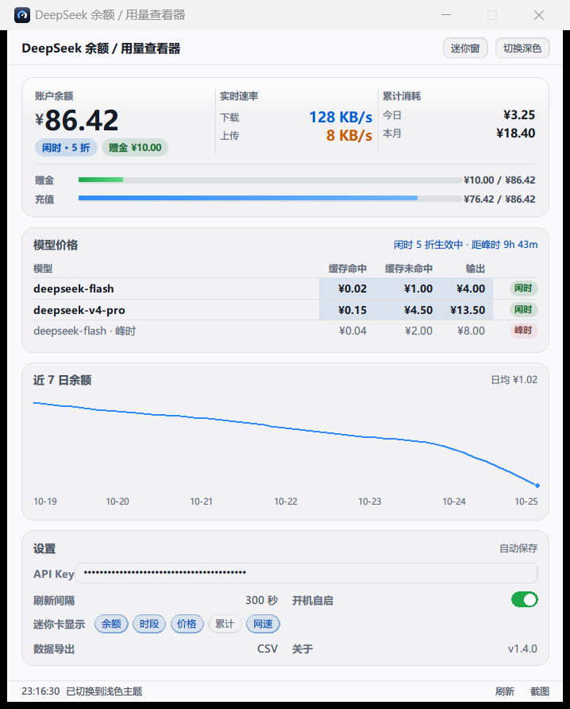
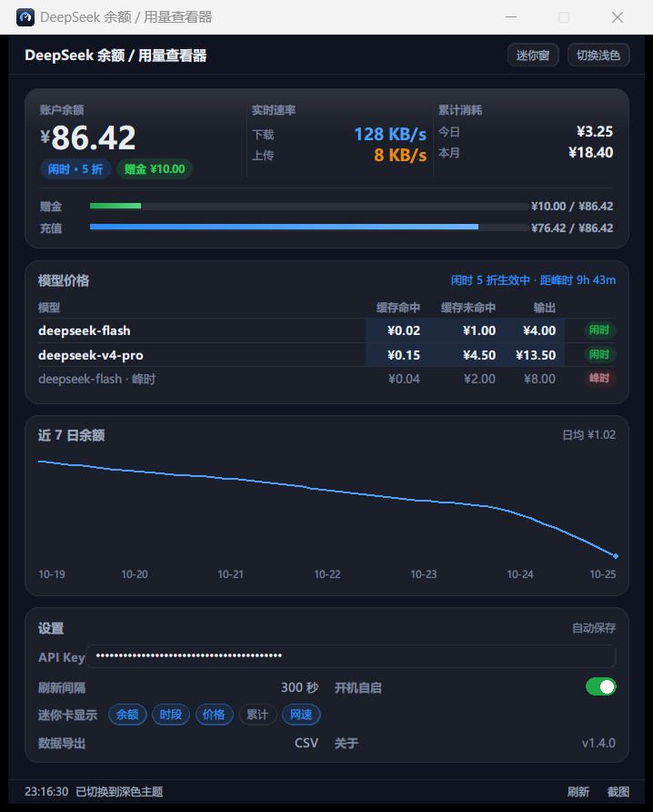

# DeepSeek 余额 / 用量查看器（Windows 桌面小应用）

<p align="center"></p>

一个轻量 Windows 桌面程序，用于查看你的 **DeepSeek 开放平台账户的余额与用量**。
核心功能纯 Python 标准库实现（tkinter + urllib + configparser + ctypes/DPAPI）。
「系统托盘」与「截图」功能需 `pystray` + `Pillow`（打包时已自动打入 exe；脚本模式 `pip install pystray pillow` 即可）。
API Key 用 Windows DPAPI 加密存于本机，不明文、不上传。

> **非官方项目**：本项目与 DeepSeek（深度求索）官方无关，仅调用其公开的
> `GET /user/balance` 接口读取你自己的账户余额。请自行评估使用风险。

## 0. 安全与隐私（重要）

- **API Key 不进仓库**：运行时 `config.ini` 与 `history.json` 固定写入
  `%APPDATA%\DeepSeekBalanceViewer\`，**不在项目目录**，且已在 `.gitignore` 中排除。
- **Key 落盘即加密**：Windows 上用 DPAPI（`CryptProtectData`，绑定当前用户）加密，
  非 Windows 退化为轻量混淆（`obf:` 前缀）。界面与日志中不回显完整 Key。
- 程序只发起一个请求：`GET https://api.deepseek.com/user/balance`，只读，不改任何账户状态。
- 「今日 / 本月消耗」是**本地采样估算**（官方未开放用量接口）：程序运行期间观察余额下降，
  把下降量累计为消耗；充值会让余额上升，不计入消耗。
  历史数据只存本机，格式为 `history.json`，随时可删。
- 如果你要提交自己的改动：**不要**把 `config.ini` / `history.json` / 任何截图提交上来。

---

## 界面预览

| 浅色主题 | 深色主题 |
|---|---|
|  |  |

**「钉在桌面」迷你卡**（无边框、窗口 region 真实裁圆角、实时网速）：

<p></p>

> 截图由 `_shot_readme.py` 生成：配置与历史都指向临时目录，余额 / 消耗 / 网速均为演示数据，
> API Key 输入框默认 `•••` 遮罩（仅聚焦时临时显示明文，失焦立刻复原）。

---

## 1. 项目结构

```
deepseek-balance-viewer/
├── main.py              # 入口，启动 UI
├── ui.py                # 业务装配：刷新线程 / 配置 / 主题 / 迷你窗 / 托盘 / 自启 / 导出
├── uikit.py             # 界面绘制层：主题 token + Canvas 原语 + MainView / MiniView 全自绘
├── api.py               # DeepSeek 接口客户端（地址与字段集中定义 + 超时重试 + 错误分类）
├── config.py            # 本地配置与 API Key 加密持久化（DPAPI / 轻量混淆）
├── history.py           # 本地余额快照（走势图 + 累计消耗估算）
├── pricing.py           # 官方价格表 + 时段判定 + 距切换倒计时（价格唯一数据源）
├── glass.py             # 液态玻璃 / 系统圆角 / DPI 的 Windows API 封装（ctypes，零依赖）
├── netmon.py            # 网速监控（ctypes 调 IPHelper，零依赖；供迷你卡实时显示上下行）
├── tray.py              # 系统托盘封装（pystray 承载，图标由 icon_art 绘制）
├── icon_art.py          # App 图标唯一来源（exe / 窗口 / 托盘三处同源绘制）
├── _make_ico.py         # 生成 app_icon.ico（7 档尺寸）与 app_icon.png
├── _doctor_history.py   # history.json 体检/修复（识别测试数据污染，默认 dry-run）
├── _mockup.html         # UI 效果图（设计稿，重构依据；改界面先改这里）
├── app_icon.ico         # exe 图标（打包时 --icon 用）
├── app_icon.png         # 图标预览 256px
├── test_logic.py        # 无界面逻辑自测（接口/加解密/价格/界面布局契约/网速/玻璃/图标）
├── _smoke_ui.py         # 界面冒烟（真实建窗 + 注入数据 + 布局/命中/重绘校验）
├── _shot_ui.py          # 截图工具（PrintWindow 抓窗口自绘内容，出验收图 + 自动审计）
├── _shot_readme.py      # 生成 README 截图（演示数据 + 遮罩 Key，docs/ 下三张图）
├── docs/                # README 用的界面截图（screenshot-light/dark/mini.png）
├── _audit_contrast.py   # 可读性门禁：逐区域 WCAG 对比度 + 拉普拉斯锐度，不过则 FAIL
├── _check_bundle.py     # 校验 exe 是否含目标模块、是否比源码旧
├── run.bat              # 一键启动（Windows）
├── requirements.txt     # 运行无依赖；打包仅需 pyinstaller
├── LICENSE              # MIT
└── README.md            # 本文件

运行时数据（**不在本目录**，已被 .gitignore 排除）：
%APPDATA%\DeepSeekBalanceViewer\config.ini     # Key（DPAPI 加密）、刷新设置、[ui] 偏好
%APPDATA%\DeepSeekBalanceViewer\history.json    # 本地余额快照
```

## 2. 依赖与环境

- **Python 3.8+**（建议从 python.org 安装，安装时勾选 *Add Python to PATH*，并确保包含 tkinter —— 官方安装包默认包含）。
- 运行期**核心功能无需**任何 `pip install`（tkinter、urllib、configparser、ctypes 均为标准库）。
- 若使用「系统托盘」或「截图」功能（默认开启）：脚本模式需 `pip install pystray pillow`；打包时本仓库已自动将其打入 exe，无需额外操作。
  **未安装也能正常启动**：托盘自动降级为「关闭窗口即退出」，截图按钮会提示缺依赖（见 `tray.TRAY_AVAILABLE`）。
- 仅当要打包成 `exe` 时才需：`pip install pyinstaller`。

## 3. 配置方式

### 3.1 填写 API Key（必做）
1. 打开 https://platform.deepseek.com ，在 *API Keys* 中创建一个新的 Key。
2. 运行程序（双击 `run.bat` 或 `python main.py`）。
3. 在顶部「设置」中粘贴 Key → 勾选是否需要「显示」确认无误 → 点击 **保存设置**。
4. Key 会以加密形式写入本机 `config.ini`，程序内与日志中均**不以明文出现**。

> 接口地址与字段都在 `api.py` 顶部集中定义（`API_BASE_DEFAULT` / `BALANCE_ENDPOINT` /
> `USAGE_ENDPOINT` / 超时与重试），如官方调整，改这里即可，无需改动其它代码。

### 3.2 自动刷新（可选）
- 勾选「自动刷新」并设置间隔（秒，最小 30），程序会在后台按间隔静默刷新，界面不卡顿。
- 关闭勾选即停止。

## 4. 运行

- **方式一（脚本，推荐调试）**：命令行进入目录执行 `python main.py`。
- **方式二（一键）**：双击 `run.bat`（优先 `pythonw` 隐藏黑框）。
- **方式三（单 exe）**：见第 6 节打包后双击 `DeepSeekBalanceViewer.exe`。

## 5. 界面说明

> **整窗 Canvas 自绘（2026-10-25 全量重构，严格对照 `_mockup.html`）**
>
> 之前用 ttk 拼装的版本与效果图差距明显——ttk 做不出圆角卡片、卡片顶部受光渐变、
> 价格表整列高亮、圆角 pill 徽章、iOS 风格 switch。所以本次重构把**主窗全部视觉**
> 交给单个 Canvas（`uikit.py::MainView`），PIL 只用于预渲染渐变/圆角位图，
> 其余全是 Canvas 原语。控件样式 100% 由代码决定，不再受 ttk 主题摆布。
>
> **布局即契约**（全部为设计稿 CSS px，改之前先看设计稿）：
>
> | 区块 | 位置 | 高度 |
> |---|---|---|
> | titlebar | y=0 | 35 |
> | Hero 三联 | y=47 | 141 |
> | 模型价格 | y=198 | 126 |
> | 近 7 日余额 | y=334 | 159 |
> | 设置 | y=503 | 137 |
> | 状态栏 | y=654 | 22 |
> | **窗口** | **560 × 676** | 内容底部正好等于窗口高 |
>
> 这些坐标由 `test_logic.py::test_ui_layout` 逐项断言，改歪了测试直接红。
>
> **尺度换算（高 DPI 不糊的关键）**：几何一律 × S（S = DPI 缩放，屏幕放不下时
> 再等比缩小）；字体用 `tkfont.Font(size=-round(px*S))`——**tk 的负数 size 是像素**，
> 所以字体物理高度同样 = 设计稿 px × S，与几何严格同比例。
>
> **交互模型**：Canvas 没有控件树，绘制时把可点矩形登记到 `_regions`，
> `<Motion>` 命中即换光标并只重绘受影响区块（不闪），`<Button-1>` 分发到 App 回调。
> 唯一需要文本输入的 API Key 用真 `tk.Entry` 通过 `place` 覆盖在圆角框上
> （它不属于 Canvas items，`delete("all")` 不会误删）。

- **titlebar**：应用名 + 右侧两个胶囊按钮「迷你窗」「切换深/浅色」。
- **Hero 三联卡**：余额 / 实时速率 / 累计消耗并排，赠金与充值比例条压到卡底一行。
  - **格 1 · 账户余额**：27px 大字 + 时段徽章（「闲时 · 5 折」/「峰时 · 2 倍价」，
    折数 = `10 / PEAK_FACTOR`，由 `pricing.py` 当前时段推导）+ 赠金徽章。
  - **格 2 · 实时速率**：下载（蓝）/ 上传（橙），**每 1 秒**刷新（与迷你窗共用同一
    网速采样器，常驻运行），自动 `B/s → KB/s → MB/s → GB/s` 进位；长时间挂机不会
    因 32 位计数器回绕出现负值跳变。
  - **格 3 · 累计消耗**：**今日 / 本月**区间消耗（`history.consumption_between`，
    仅累计余额下降部分、回充不计入；基准取区间前最后一条快照，跨天边界不重不漏）。
  - **卡底双比例条**：赠金（绿渐变）/ 充值（蓝渐变）占总余额比例 + 数值。
- **模型价格**：3 行紧凑表 —— 当前时段各模型一行（当前列整列淡蓝高亮）+ 末尾一行
  另一时段对比（置灰、状态 pill 降一档浓度）。右上角实时显示
  「闲时 5 折生效中 · 距峰时 2h 14m」（倒计时来自 `pricing.next_period_change()`），
  **点击它**弹出价格说明（单位 / 模型版本 / 并发限制 / 高峰规则 / 价格来源快照）。
  - 数据唯一来源是 `pricing.py::PRICING_OFFPEAK`（空闲时段单价），
    高峰价按官方规则「空闲 × `PEAK_FACTOR`」自动推导。
  - 官方口径：高峰 = 北京时间周一至周五（不含法定节假日）9:00-12:00、14:00-18:00；
    其余时段（含周末与节假日全天）为空闲。本程序**不自动识别法定节假日**，
    节假日当天会保守地把高峰窗口算作高峰（仅影响展示，不影响账户数据）。
  - 在售模型仅两个：`deepseek-flash`（DeepSeek-V4.1-Flash）、`deepseek-v4-pro`（DeepSeek-V4-Pro-0813）。
    旧名 `deepseek-v4-flash`、`deepseek-v4-flash-vision-exp` 对应模型已下线（仍可调用但按 Flash 计费），
    故不单独列出；「图像理解」是 `deepseek-flash` 的能力，不是独立模型。
  - 如官方调价，只需改 `pricing.py` 里 `PRICING_OFFPEAK` 的数字与 `PRICING_SNAPSHOT`
    （`test_logic.py::test_pricing` 是回归护栏，改错会直接报错）。
- **近 7 日余额**：按天取样绘制面积渐变曲线 + 7 个日期轴，右上角「日均 ¥x.xx」。
- **设置（grid 两列）**：API Key（横跨）/ 刷新间隔 / 开机自启（switch）/ 迷你卡显示
  （5 个可多选 chips）/ 数据导出 CSV / 关于（版本号）。全部**即时保存**，无「保存」按钮。
- **状态栏**：左侧最近一次操作的时间与结果，右侧「刷新」「截图」快捷入口。
  （设计稿无此栏，但状态反馈是必要功能，故保留为一行细条。）

**与设计稿的 3 处有意差异**（其余逐像素对齐）：
1. 保留 Windows 原生标题栏（设计稿只有一行自绘标题）——换取最小化/贴靠/任务栏等系统能力；
2. 状态栏（见上）；
3. API Key 输入框默认**明文**（设计稿画的是 `sk-••••`），否则无法核对粘贴是否完整。

## 5.1 「📌 钉在桌面」迷你模式（零依赖）

点击设置区的「📌 钉在桌面」按钮，主窗口隐藏，弹出一个**无边框、始终置顶**的迷你悬浮卡，可钉在桌面任意角落：

- **拖拽移动**：在卡片任意位置按住左键拖动。
- **双击刷新**：立即手动刷新余额与时段价格。
- **右键菜单**：「恢复完整窗口」「手动刷新」「退出」三个操作。
- **显示项可配置**：设置区的「迷你卡显示项」可勾选 **余额大字 / 当前时段 / 计费单价 / 累计消耗 / 网速监控**
  （默认为前两项 + 网速监控）。勾选**即时生效**——迷你窗开着时会立即重建内容，无需重开；
  配置写入 `config.ini` 的 `[ui]` 段（`mini_show_balance` / `mini_show_period` /
  `mini_show_price` / `mini_show_consumption` / `mini_show_net`），下次启动保持。
- **网速实时监控**：勾选后迷你卡多出「网速监控」块，**每 1 秒**刷新一次 `↓ 下载` / `↑ 上传` 速率，
  自动按 `B/s → KB/s → MB/s → GB/s` 进位（保留 2 位小数），长时间挂机也不会因 32 位计数器回绕而出现负值跳变。
- **窗口尺寸自适应**：迷你窗不再固定 `230x150`，而是按当前内容所需尺寸**指数缓动**平滑伸缩
  （约 12 帧 / 16ms 一帧），随勾选项增减、速率文字长短变化自动增高变宽，**文字始终完整显示、不截断不溢出**。
  内容天然尺寸由 `winfo_reqwidth/reqheight` 读出，无需手写各项的高度常量。
- 自动刷新照常后台运行，迷你卡随每次刷新同步更新余额与时段的当前计费价。
- 迷你卡默认出现在屏幕右上角，避免遮挡主工作区。

> 该模式纯用 tkinter 原生能力（`overrideredirect` 去边框 + `wm_attributes("-topmost", True)` 置顶）实现，不引入任何第三方依赖，不影响单 exe 打包。

### 迷你卡视觉（`uikit.MiniView` 全自绘；真玻璃 `[ui] glass` 可选）

迷你卡容器为**圆角矩形卡片**，默认走实底（`MINI_THEMES[*]["card"]`）+ 顶部 3px 受光
+ 1px 内描边 + 独立半透明投影层，圆角由 `SetWindowRgn` 裁剪——不依赖 DWM 合成，
**任何壁纸下文字对比度都稳定**。

真·液态玻璃（背后桌面实时模糊透出）仍完整保留，把 `config.ini` 的 `[ui] glass`
改成 `true` 即启用，零第三方依赖。配方参考业界实现（PyPI `py-window-styles` 的
tk acrylic、Qt `BlurWindow`），2026-10-25 实测于 Win11 26300 + Tk 8.6：

> ⚠️ 开启后的代价与主窗相同：`extend_frame(-1)` 会把整窗纳入 DWM 合成，GDI 文字
> 被 backdrop 稀释（`_audit_contrast.py` 实测掉到 1.5~4.0:1）。主窗已因此默认关闭，
> 迷你卡同理。以下配方作为「可选观感」保留记录。

- **真 acrylic（背景模糊）**：卡面铺**纯黑**作「玻璃掩膜」，`glass.apply_acrylic` 调
  `SetWindowCompositionAttribute(Attribute=30, AccentState=3, GradientColor=tint)`，
  DWM 把黑色像素替换为**背后实时模糊 + 染色**的 backdrop——
  透出的是真实桌面内容（壁纸 / 其它窗口）。
  配方与 PyPI `py-window-styles`（Akascape）的 "acrylic" 样式逐行一致。
  ⚠ `AccentState=4`（ACRYLICBLURBEHIND）在已发布 Windows 上**从未实装**——API 返回
  成功但不渲染，窗口就是一张实底黑卡；必须用 `AccentState=3`（BLURBEHIND）。
- **整窗纳入 DWM 合成**：`DwmSetWindowAttribute(DWMWA_USE_IMMERSIVE_DARK_MODE=20, 1)` +
  `DwmExtendFrameIntoClientArea(MARGINS(-1,-1,-1,-1))`，backdrop 才稳定渲染。
- **⚠ 不用 `-transparentcolor` 色键**：本机 Tk 8.6 上一设色键，窗口**所有内容**
  （文字、不透明底色）全部停止渲染——黑底掩膜路线无此问题，文字清晰可读。
- **⚠ `winfo_id()` 不是顶级 HWND**：tkinter 的 Toplevel（尤其 `overrideredirect`）
  `winfo_id()` 返回子窗口句柄，DWM API 只收顶级窗口（否则 `err=6 ERROR_INVALID_HANDLE`）。
  `glass.get_toplevel_hwnd()` 先用 `GetParent`（回退 `GetAncestor(GA_ROOT)`）解析再调用。
- **⚠ 时序关键（实测 Win11 26300）**：dark 属性 → accent → extend frame → **region 最后**——
  **窗口 region 变更是让 DWM 渲染 backdrop 的可靠触发**（`SWP_FRAMECHANGED` /
  `RedrawWindow` 均无效）；仅 apply accent 时 backdrop 可能不渲染。
  故 `_open_mini` / 切主题后都会补一次 `_ensure_glass`，autosize 缓动每帧也会自然重刷 region。
- **圆角**：`glass.set_round_region` 用 GDI `CreateRoundRectRgn` + `SetWindowRgn` 裁剪
  （`GLASS_RADIUS=16`），内部按 `GetDpiForWindow` 把逻辑像素换算成物理像素——高 DPI / 多显示器下圆角精准不变形。
- **柔和阴影**：独立半透明黑窗（`mini_shadow`，比卡大一圈、右下偏移）作投影层，随卡片移动 / 缩放 / 跨屏同步（`_sync_shadow`）。
- **半透明层次 + 边缘高光**：acrylic 染色由主题 tint 控制（dark `0x292929` 16% 深灰染 /
  light `0x40F0F0F0` 25% 白染，取值对照 pywinstyles 实测配方），
  叠加顶部受光高光带（`_add_glass_highlight`）+ 1px 内描边（Frame `highlightbackground`）。
  玻璃生效时卡面为黑掩膜色（`MINI_THEMES[*]["mask"]`），文字 / 高光 / 描边走主题色画在上层。
- **明 / 暗双主题**：`MINI_THEMES` 两套色板，默认跟随系统 `AppsUseLightTheme`，右键「切换深/浅色」即时切换并持久化（`mini_theme`，空=跟随系统）。文字三级层次（主/次/弱）与苹果强调色（下载蓝 / 上传橙 / 空闲绿 / 峰值红）保证任意背景下高对比可读。
  **浅色版已全面加深**（2026-10-25，白染玻璃上对比度全部 ≥ WCAG AA）：主/次/弱文字 `#141A23 / #46505F / #6E7683`，下载蓝 `#0062D6`、上传橙 `#C75B00`、空闲绿 `#1E7A38`、峰值红 `#B3231A`，内描边 `#B9C0CC`。
- **实底是默认路径（不是降级）**：`[ui] glass = false` 时卡面即 `card` 实底色 +
  圆角 + 受光 + 描边；acrylic 不可用（非 Windows / API 失败）时也自动落在同一条路径，
  绝不出现"全透明看不到卡"。
- 性能：DWM 合成模糊（GPU），圆角/阴影仅在创建、autosize、主题切换时重算；网速每秒只改文字，不触发重绘。

### 主程序窗口：默认实底，真玻璃是**可选且已知会降低可读性**（2026-10-25 修正）

⚠️ **这是一次纠错，别再改回去。** 上一版主窗默认套了真 acrylic，用户真机截图反馈
「完全看不清」。用 `_audit_contrast.py` 量化后确认了两个真实缺陷：

| 缺陷 | 现象 | 量化 |
|---|---|---|
| Canvas 底色硬编码 `#000000` | 标题栏 / 卡片间隙 / 状态栏全是纯黑，深色文字画在黑底上直接"消失" | — |
| `AccentState=3(BLURBEHIND)` + `extend_frame(-1)` | DWM 重新合成**整块客户区**，Tk 用 GDI 绘制的文字被一并模糊、被背后壁纸冲淡 | 明细行对比度掉到 **1.45:1**（WCAG AA 要求 4.5） |

机理：`DwmExtendFrameIntoClientArea(-1)` 把整窗纳入 sheet-of-glass，DWM 会把客户区
当玻璃面板重新合成，GDI 文本落在这个合成层里就被 backdrop（桌面壁纸）稀释了。
**这与配色无关，调色救不回来**——用户壁纸是亮蓝紫，深色文字直接被冲白。

因此现在的策略：

- **默认实底**（`config.ini` 的 `[ui] glass = false`）：Canvas 底色 = 主题窗底
  （`MAIN_THEMES[*]["win_bg"]`），并在渲染时**显式铺满一个窗底矩形**，不依赖
  Canvas 原生底色。玻璃质感靠静态手法给足：圆角卡片 + 顶部受光渐变 + 1px 描边 +
  分级叠色（`_mix()` 把设计稿 rgba 换算成实色）。像素级可控，对比度稳定
  **13:1 ~ 20:1**。
- **系统级细节仍保留**：Win11 系统圆角
  （`DWMWA_WINDOW_CORNER_PREFERENCE=33, DMWCP_ROUND=2`，保留贴靠/缩放/阴影，
  Win10 静默降级直角）、原生标题栏明暗跟随主题（`DWMWA_USE_IMMERSIVE_DARK_MODE`）。
- **想体验真玻璃**：把 `[ui] glass` 改成 `true`。代价是文字发虚（见上表），
  这是纯观感取舍，功能完全不受影响。`glass.clear_window_glass()` 负责在使用
  实底时主动撤销 DWM 合成状态，避免残留。

### 可读性门禁（`_audit_contrast.py`，2026-10-25 新增）

把「看不清」这种主观判断变成可回归的硬指标，**每次截图后自动跑**：

- **文字对比度**：区域内「众数色(卡片底)」vs「与底色亮度差最大的 0.4% 像素(文字笔画)」
  的 WCAG 对比度，7 个文字密集区域逐个判定，阈值 `4.5:1`；
- **锐度**：拉普拉斯方差，糊字会显著偏低。

```bash
python _shot_ui.py            # 真实默认路径（实底）→ 截图后自动审计，应 PASS
python _shot_ui.py --glass    # 强制开真玻璃 → 审计应 FAIL（反面取证）
```

自检有效性：拿用户那张问题截图跑，得 `1.18 ~ 2.42`（FAIL）；修复后得 `8.2 ~ 20.1`（PASS）。

### 网速采样实现要点（`netmon.py`）

用 `ctypes` 直接调 Windows IPHelper 的 `GetIfTable` 读网卡累计字节数，两次采样差分得到速率，**不装 psutil 等第三方库**：

- **必须去重**：同一张物理网卡的上行/下行计数器会被 WFP（`WFP Native` / `WFP Virtual`）、
  `WinpkFilter`、QoS 等**过滤模块重复上报**，实测 1 张 Wi-Fi 卡被复制约 14 份。
  若直接对所有行求和，网速会虚高十几倍。因此先用 `GetAdaptersInfo` 取**真实适配器索引集合**，
  只累加这些索引对应的行（过滤模块不是 IP 适配器，自然被排除）。
- **不要依赖 `OperStatus == 1`**：活跃网卡实测可能报 `5`（Dormant）而非 `1`（Up），
  按状态位过滤会读成 0，表现为永远 `0 B/s`。改为按"真实索引"过滤即可，无需状态位。
- 32 位计数器回绕保护：`cur < prev` 时按 `2**32` 补偿，避免速率出现巨大负值。
- 采样失败（非 Windows / 接口不可用）时显示 `不可用`，不影响余额主功能。
- **多显示器适配**：迷你窗可拖到任意显示器（含副屏）。自适应尺寸做边界 clamp 时，
  用的是 `MonitorFromWindow` + `GetMonitorInfoW` 取得的**窗口当前所在显示器**的 work area，
  而非 `winfo_screenwidth/height`（后者在多屏 Windows 只返回主屏，会把副屏上的窗口误判越界并 snap 回主屏）。
  因此拖到副屏不会被每秒刷新的 autosize 拉回主屏。

## 5.2 系统托盘 / 开机自启 / 数据导出

- **系统托盘驻留**：关闭主窗口不再直接退出，而是最小化到系统托盘（任务栏右下角），
  托盘图标右键菜单可「显示主窗口 / 钉在桌面 / 刷新 / 退出」。托盘图标由 `Pillow` 现画（绿底 DS），无需外部图片。
  若运行环境无桌面（如服务器会话），托盘会自动降级：关闭窗口即直接退出，不影响主功能。
- **开机自启**：在「设置」中勾选「开机自启（启动即钉桌面迷你窗）」，程序会写入
  `HKCU\Software\Microsoft\Windows\CurrentVersion\Run`，下次登录自动以**迷你窗**模式启动（带 `--mini` 参数）。取消勾选即移除。
- **导出 CSV**：「设置」区的「导出 CSV」按钮，把 `history.json` 中的余额历史导出为
  `balance_history_YYYYMMDD.csv`（含时间 / 币种 / 总余额 / 累计消耗），方便月度对账。文件带 UTF-8 BOM，Excel 可直接打开。
- **截图**：「截图」按钮用 `Pillow` 截取当前可见窗口（优先迷你窗，否则主窗）为
  `balance_snapshot_YYYYMMDD_HHMMSS.png`，便于分享或留底。

## 6. 打包为单 exe

```bat
pip install pyinstaller pystray pillow
python -m PyInstaller main.py --noconsole --onefile --name DeepSeekBalanceViewer ^
  --icon app_icon.ico ^
  --hidden-import tray --hidden-import pystray --hidden-import pystray._win32 ^
  --hidden-import icon_art ^
  --hidden-import PIL --hidden-import PIL.Image --hidden-import PIL.ImageDraw ^
  --hidden-import PIL.ImageGrab
```
产物：`dist/DeepSeekBalanceViewer.exe`（单文件、`--noconsole` 无黑框）。
拷贝该 exe 到任意 Windows 机器即可运行。

> 图标：`app_icon.ico` 由 `_make_ico.py` 生成（图形来自 `icon_art.py`）。
> 改了图标图形要先 `python _make_ico.py` 再打包，否则 exe 里还是旧图标。
> 不想带图标可去掉 `--icon` 一行（会退化成 PyInstaller 默认图标）。

> **配置与历史数据不在 exe 旁边**：`config.ini` / `history.json` 固定写到
> `%APPDATA%\DeepSeekBalanceViewer\`（见 `config.py::app_data_dir()`）。
> 这是因为 `--onefile` 运行时会把脚本释放到系统临时目录（`sys._MEIPASS`），
> 进程退出即清理——若把配置写在 `__file__` 旁边，重启后 Key 与历史会**全丢**。

> **已构建版本（2026-10-08）**：`dist/DeepSeekBalanceViewer.exe`，单文件约 20.4 MB（含托盘 + 截图依赖 + `netmon`）。
> 用系统 Python 3.14 + PyInstaller 6.22.3 打包；额外的 `pystray` + `Pillow` 由 hidden-import 自动收集
> （`netmon` 是本项目普通模块，被 `ui.py` 直接 import，打包器会自动收录，无需显式声明）。
> 构建中间产物 `build-venv/`、`build/`、`build2/`、`build3/`、`dist2/`、`dist3/` 可安全删除（重新打包时再装 / 再生成）。
> 注意：打包需在**带 tkinter 的 Python** 上进行（如 python.org 安装版）；本项目的托管 Python 为 headless 构建不含 tkinter，不能用来打包。
>
> ⚠️ **改了源码一定要重新打包，否则你看到的还是旧 exe 的行为**：
> 用户日常双击的是 `dist/DeepSeekBalanceViewer.exe`，它是**打包时的快照**，不会跟随 `.py` 源码变化。
> 典型症状：源码里明明加好了新功能、测试也全绿，但界面/迷你卡上"就是没有"。
> 排查方法：比对 `dist/*.exe` 的修改时间与最新 `.py` 的修改时间；再确认 `config.ini` 里是否缺少新功能对应的配置键
> （旧 exe 不认识这个键，自然不会写入）。两项都对上，就说明该重新打包了。
> 快速自证新包是否含目标模块、以及是否"源码比 exe 新"（无需启动 GUI）：
> ```bat
> build-venv\Scripts\python.exe _check_bundle.py netmon ui tray
> ```
> 输出 `RESULT: PASS` 才算产物是最新的；若报 `STALE`，说明源码改了没重打包。
> 视觉留证见 `_shot_netmini.py`：启动新包 → 定位迷你窗 → 截图（本机 125% DPI 的坐标换算坑见该文件注释）。
>
> **重打包时若报"无法删除旧产物"（PermissionError / trash 失败）**，按顺序排查两件事：
>
> 1. **旧 exe 进程是否还在运行**（最常见原因）：Windows 上 exe 运行时会锁住自身文件，
>    PyInstaller 既删不掉也覆盖不了。**每次用 `timeout`/双击验证启动后，务必结束进程**：
>    ```bat
>    taskkill /F /IM DeepSeekBalanceViewer.exe
>    ```
>    （注：onefile 模式会同时存在引导进程与主进程，看到 2 个进程属正常。）
> 2. 目录本身被安全策略保护（`rm` / `mv` / `shutil.rmtree` 均可能被拦）时，
>    改用**全程只创建、不删除**的路径：
>    ```bat
>    pyinstaller --noconsole --onefile --name DeepSeekBalanceViewer ^
>      --distpath dist2 --workpath build2 --specpath build2 ^
>      --hidden-import tray --hidden-import pystray --hidden-import pystray._win32 ^
>      --hidden-import PIL --hidden-import PIL.Image --hidden-import PIL.ImageDraw ^
>      --hidden-import PIL.ImageGrab main.py
>    ```
>    随后用**写入覆盖**（不删除、不重命名）把新 exe 放回 `dist/`：
>    ```bat
>    python -c "d=open('dist2/DeepSeekBalanceViewer.exe','rb').read(); open('dist/DeepSeekBalanceViewer.exe','wb').write(d)"
>    ```

## 7. 验证步骤

### 7.1 正常场景
1. 填入有效 Key → 保存 → 点「手动刷新」。
2. 预期：状态栏显示「刷新成功」，余额大数字出现，进度条与走势图更新。
3. 勾选自动刷新（如 60 秒），等待片刻，确认界面自动更新且不卡顿。
4. **折叠验收**：点「余额构成」「最近用量」「API 价格」任一块的标题行 → 内容收起、箭头变 ▸、
   右侧仍显示摘要；再点一次展开。刷新一次并重启程序，确认折叠状态被记住（看 `config.ini` 的 `[ui]` 段）。

### 7.4 迷你窗网速监控验收
1. 点「📌 钉在桌面」→ 迷你卡应出现「网速监控」块，初始显示 `↓ 下载 -- / ↑ 上传 --`，
   约 1 秒后（首次采样需要两个时间点）变为真实速率，形如 `↓ 下载 16.60 KB/s`。
2. **数值合理性**：静止挂机时应接近 `0 B/s`，打开网页 / 下载文件时明显上升；
   若数值恒定虚高到数十 MB/s，说明网卡计数器被重复累加（见 `netmon.py` 的去重说明）。
3. **自适应尺寸**：在设置里勾选/取消「计费单价」「累计消耗」→ 迷你窗应**平滑**增减高度，
   文字完整显示，无截断、无溢出、无横向空白突变。
4. **单位进位**：下载大文件时观察单位自动从 `KB/s` 跳到 `MB/s`（2 位小数）。
5. **清理**：关闭迷你窗（右键「恢复完整窗口」或「退出」）后，网速定时器应停止；
   重复开关多次不产生定时器泄漏（可看 CPU 占用是否回落）。
6. **打包版一致性**：确认运行的 `dist/*.exe` 构建时间晚于最新源码，
   否则源码里的新功能不会出现（`_check_bundle.py` 可一键判定）。

### 7.2 异常场景
| 场景 | 操作 | 预期提示 |
|------|------|----------|
| 未配置 Key | 清空 Key 启动 | 主区显示「尚未配置 API Key」引导；点刷新状态栏提示无法刷新 |
| Key 无效/被吊销 | 填入错误 Key 刷新 | 弹窗「API Key 错误」+ 状态栏对应信息（HTTP 401） |
| 网络失败/超时 | 断网或改错 base_url 刷新 | 弹窗「网络异常」+ 状态栏信息（含超时/连接失败） |
| 请求被限流 | 频繁刷新触发 429 | 弹窗「请求被限流」+ 自动指数退避重试（最多 3 次） |
| 服务端 5xx | 官方抖动时刷新 | 弹窗「服务端错误」+ 退避重试 |
| 用量接口未公开 | 正常刷新 | 用量区诚实显示「官方用量接口暂未公开」，不报错 |

### 7.3 安全自检
- 打开 `%APPDATA%\DeepSeekBalanceViewer\config.ini`，确认 `api_key_encrypted` 为
  `dpapi:...` 或 `obf:...` 密文，非明文 `sk-...`。
- 确认程序除 `api.deepseek.com` 外无任何外发请求（可在防火墙/代理处核对）。
- 仓库自检：`git ls-files | grep -E "config.ini|history.json|\.png$"` 应为空（只有 `app_icon.png`）。

## 8. 设计要点说明

- **为什么用量是「本地追踪」？** DeepSeek 公开 API 目前只提供 `GET /user/balance`，
  没有公开「请求数 / Token 用量」接口。本程序在 `api.py` 预留了 `USAGE_ENDPOINT` 与解析位，
  一旦官方开放即可启用；在此之前用本地余额下降量作为消耗代理指标，并如实标注。
- **为什么用标准库？** 为了零依赖、易打包、易审计，且对 Key 的加密直接使用系统级 DPAPI，
  比自己写加密更可靠。
- **界面不卡顿**：所有网络请求在后台线程执行，结果通过 `after()` 回主线程更新 UI。
